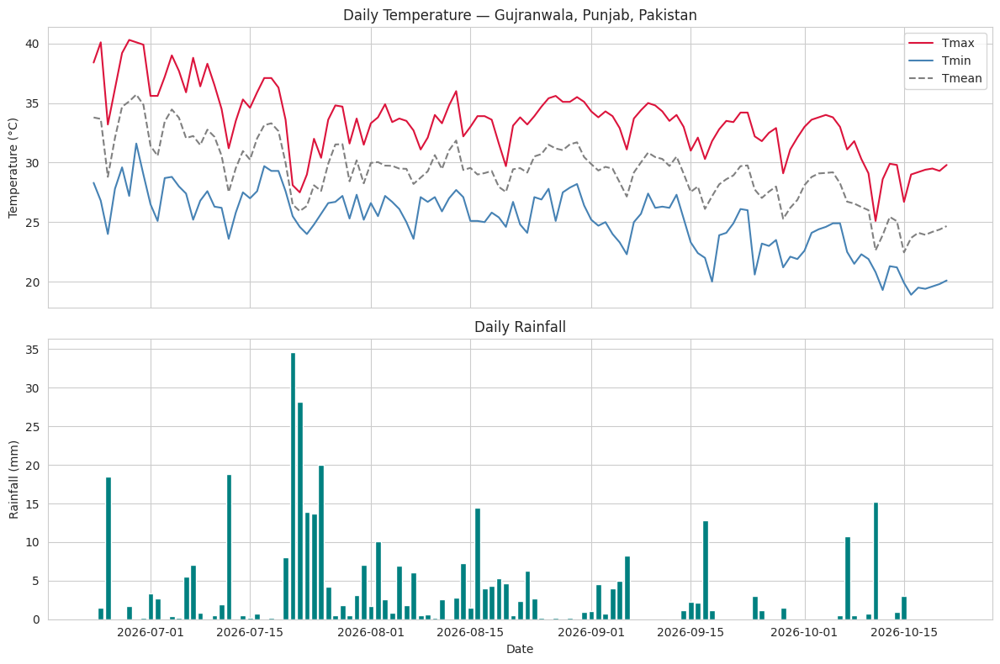
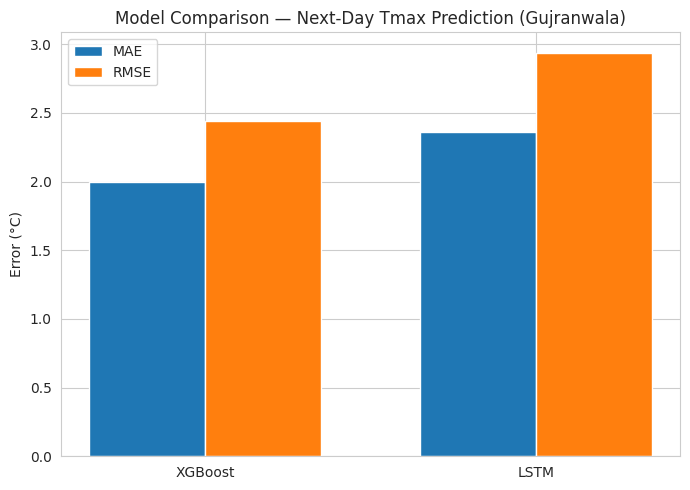
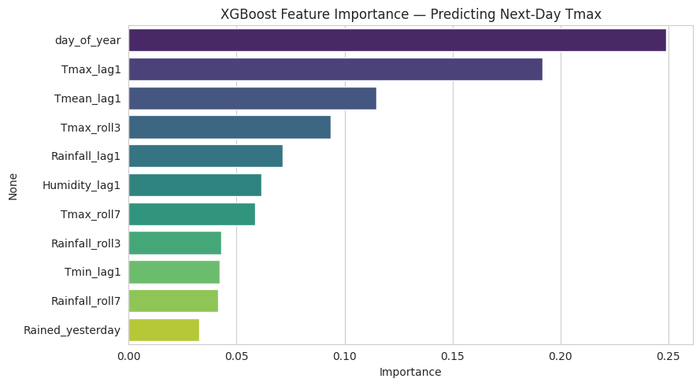
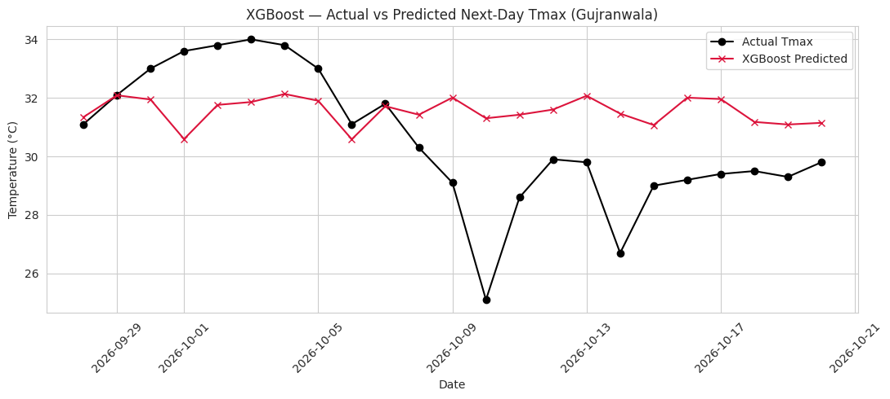
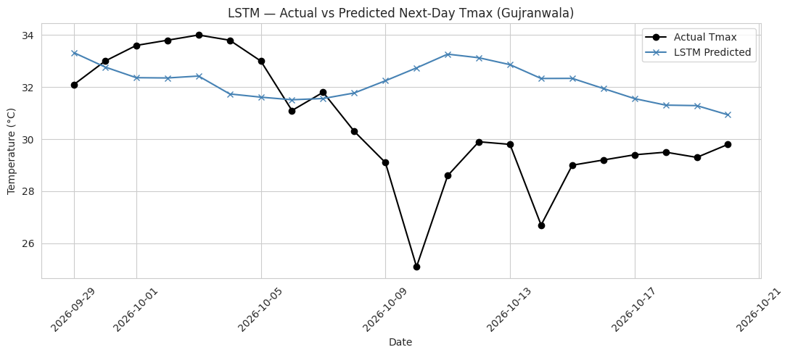
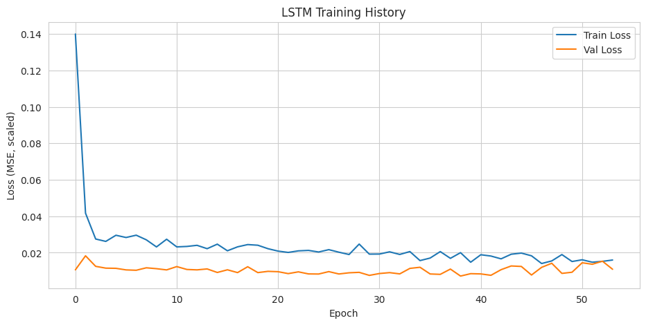

# Gujranwala Next-Day Temperature Forecasting

[](https://colab.research.google.com/github/faseeh-tahir-gis/gujranwala-temperature-forecasting/blob/main/notebooks/Gujranwala_Temperature_Rainfall_Forecasting.ipynb)
[](https://nbviewer.org/github/faseeh-tahir-gis/gujranwala-temperature-forecasting/blob/main/notebooks/Gujranwala_Temperature_Rainfall_Forecasting.ipynb)
[](LICENSE)

A machine learning project that predicts the **next-day maximum temperature (Tmax) for Gujranwala, Punjab, Pakistan** from recent temperature, rainfall and humidity, comparing an **XGBoost** regressor with a two-layer **LSTM** neural network.

Original Colab notebook: https://colab.research.google.com/drive/1POKJR7UO0zqms9ltnE0TCrTpftN5OMKi

**Author:** Faseeh Tahir, BS Geography, University of Gujrat
**Context:** Project completed during the internship at AI Geo Navigator, Future Leadership Internship Program 2026.

---

## Run it yourself

Click the **Open in Colab** badge above, then choose **Runtime, Run all**. No API key is needed. The notebook downloads fresh data every time it runs, so dates and results will differ from the ones reported below.

To run locally instead:

```
pip install -r requirements.txt
jupyter notebook notebooks/Gujranwala_Temperature_Rainfall_Forecasting.ipynb
```

The cell that opens an interactive spreadsheet (`google.colab.sheets`) only works inside Google Colab. Skip it when running locally.

## Project at a glance

| Item | Detail |
|---|---|
| Location | Gujranwala, Punjab, Pakistan (32.1877 N, 74.1945 E), timezone Asia/Karachi |
| Data source | Open-Meteo Historical Weather API (hourly temperature, precipitation, relative humidity) |
| Training window | 23 June to 21 October 2026 (121 daily records, 114 after feature engineering) |
| Target | Next-day maximum temperature (`Tmax_next_day`) |
| Features | 11 (lags, rolling statistics, rainfall indicator, day of year) |
| Models | XGBoost Regressor, LSTM (two layers, 5-day lookback) |
| Metrics | MAE and RMSE in degrees Celsius |
| Split | Chronological 80/20, no shuffling |

## Workflow

1. **Collect.** Hourly data is requested from Open-Meteo for two windows: the last 7 days (for the observation log) and about 120 days (for training).
2. **Observation log.** The 7-day hourly data is reduced to two readings per day, at 08:00 and 20:00, and saved as [`data/gujranwala_7day_observations.csv`](data/gujranwala_7day_observations.csv).
3. **Clean and aggregate.** Hourly values become daily Tmax, Tmin, Tmean, total rainfall and mean humidity. No missing values were found.
4. **Engineer features.** Previous-day values, 3-day and 7-day rolling statistics, a rain indicator and day of year.
5. **Split.** The first 80% of days train the models and the most recent 20% test them.
6. **Model.** XGBoost on the tabular features and an LSTM on 5-day sequences.
7. **Evaluate and compare.** MAE and RMSE on the test period, plus actual-versus-predicted plots.

Full details are in [docs/METHODOLOGY.md](docs/METHODOLOGY.md).



## Features used

| Group | Features |
|---|---|
| Previous-day values | `Tmax_lag1`, `Tmin_lag1`, `Tmean_lag1`, `Rainfall_lag1`, `Humidity_lag1` |
| Rolling statistics | `Tmax_roll3`, `Tmax_roll7`, `Rainfall_roll3`, `Rainfall_roll7` |
| Rainfall indicator | `Rained_yesterday` (rainfall above 0.1 mm) |
| Seasonal | `day_of_year` |

## Results

Test period: 28 September to 20 October 2026 (23 days for XGBoost, 22 sequences for the LSTM).

| Model | MAE (°C) | RMSE (°C) |
|---|---|---|
| XGBoost | 2.00 | 2.44 |
| LSTM | 2.36 | 2.94 |

On this test period XGBoost has the lower error. The two numbers are not strictly comparable, because the LSTM sequence set is built differently (see Known issues below).

| | |
|---|---|
|  |  |







Result tables are also stored as [`results/model_comparison.csv`](results/model_comparison.csv) and [`results/xgboost_feature_importance.csv`](results/xgboost_feature_importance.csv).

## Repository structure

```
gujranwala-temperature-forecasting/
├── README.md
├── LICENSE
├── requirements.txt
├── .gitignore
├── notebooks/
│   └── Gujranwala_Temperature_Rainfall_Forecasting.ipynb
├── data/
│   └── gujranwala_7day_observations.csv
├── results/
│   ├── model_comparison.csv
│   ├── xgboost_feature_importance.csv
│   └── figures/                      (six figures from the notebook)
└── docs/
    └── METHODOLOGY.md
```

## About the data

The temperature, rainfall and humidity values come from the **Open-Meteo Historical Weather API**, which serves gridded weather model and reanalysis data for a coordinate. They are not readings taken by an instrument at a field site, and the 08:00 and 20:00 "observation log" is extracted from the same hourly series. Values can differ from official station records.

## Known issues and limitations

These are listed so the results are read with the right caution.

1. **Small sample.** About 4 months of daily data (91 training days, 23 test days) is very little for XGBoost and especially for an LSTM.
2. **Season shift.** Training covers late June to late September (summer and monsoon) and testing covers autumn cooling. The XGBoost predictions in the plot stay close to 31 to 32 °C while actual Tmax falls to 25 to 30 °C, so the 2.0 °C MAE mostly reflects a model that has not seen the cooler season.
3. **Day of year.** `day_of_year` is the most important feature, but with a single summer-to-autumn stretch of data it works as a time trend and will not carry over to other seasons. Several years of data are needed to learn a real seasonal cycle.
4. **No baseline.** The notebook does not compare against a simple benchmark such as "tomorrow's Tmax equals today's Tmax", so it is unclear how much the models add.
5. **LSTM target alignment.** Each feature row already holds the target for the following day. The sequence builder then pairs 5 rows of features with the target of the row after them, so the LSTM learns a prediction one day further ahead than the XGBoost model. Its metrics and its "tomorrow" forecast are therefore not directly comparable to XGBoost.
6. **Scaler leakage.** The LSTM scalers are fitted on the full dataset before the train/test split, so test-period statistics leak into scaling. The effect is small but should be removed.
7. **Final forecast date.** The notebook's "tomorrow" forecast is for 21 October 2026, which is the last day already present in the downloaded data, because the most recent row is dropped when the next-day target is built. It is a prediction for a day with known data, not a forecast of a future day.
8. **Single run.** Results come from one run with a fixed random seed (42). The notebook downloads new data on each run, so numbers will change.

## Possible improvements

- Use several years of history and test across seasons
- Add a persistence baseline and report skill against it
- Fix the LSTM alignment and fit scalers on training data only
- Add rolling-origin validation instead of a single split
- Compare with observations from a ground weather station

## License

MIT. See [LICENSE](LICENSE). Weather data are provided by [Open-Meteo](https://open-meteo.com/) and are subject to their terms of use.

## Citation

> Tahir, F. (2026). *Gujranwala Next-Day Temperature Forecasting with XGBoost and LSTM.* University of Gujrat.
